<h1 align="center">🌡️ Climate Trend Analyzer</h1>

<p align="center">
  <b>End-to-end climate analytics pipeline: 35 years of daily data for 4 Indian cities →<br>
  cleaning → trend tests → anomaly detection → forecasting → interactive dashboard.</b>
</p>

<p align="center">
  
  
  
  
  
  
  
</p>

<p align="center">
  
</p>

---

## 📌 Key results at a glance

| Question | Answer (from this pipeline) |
|---|---|
| Is it getting warmer? | **Yes, in all 4 cities** — Mann-Kendall p < 0.001 |
| How fast? | **+0.18 to +0.32 °C per decade** (Sen's slope); Delhi fastest |
| More heat extremes? | Hot days per year **roughly doubled** (≈ 26 → 46–56) between the 1990s and the last decade |
| Is rainfall changing? | **No significant trend** in annual totals — year-to-year variability dominates |
| Can we catch extreme events? | **98 % of injected heatwaves**, 94 % of cold spells, 85 % of extreme-rain days detected |
| How accurate is the forecast? | Monthly temperature RMSE **0.37–0.74 °C** on a 3-year hold-out, beating the seasonal-naive baseline by 26–42 % |

> ⚠️ **Data note.** Results come from a **virtual simulation** of daily climate built to mimic Indian city climates (see [Dataset](#-dataset)). Because the true warming rate and extreme events are known, the simulation lets us *measure* how well the methods recover them. The same pipeline runs unchanged on **real NASA POWER data** with one command.

---

## 📖 Table of contents
[Overview](#-project-overview) · [Problem](#-problem-statement) · [Industry relevance](#-industry-relevance) · [Tech stack](#-tech-stack) · [Architecture](#-architecture) · [Folder structure](#-folder-structure) · [Installation](#-installation) · [Dataset](#-dataset) · [How to run](#-how-to-run) · [Simulation workflow](#-virtual-simulation-workflow) · [Results](#-results) · [Screenshots](#-screenshots) · [Future work](#-future-improvements) · [Learning outcomes](#-learning-outcomes) · [Author](#-author)

---

## 🔍 Project overview

**Climate Trend Analyzer** turns raw daily weather records into evidence about long-term climate change. It answers four questions that climate agencies, city planners and researchers ask every year:

1. **Is the climate changing?** → statistical trend tests (OLS, Mann-Kendall, Sen's slope)
2. **When in the year is it changing most?** → seasonal decomposition and seasonal warming rates
3. **What was unusual?** → anomaly detection (Z-score, percentile thresholds, Isolation Forest)
4. **What happens next?** → back-tested forecasting (Seasonal Naive vs Linear vs SARIMA)

Everything is reproducible with one command and explored through a Streamlit dashboard.

## ❓ Problem statement

Climate data is **noisy** (a hot week is not climate change), **seasonal** (summer is always hotter than winter), and **messy** (sensor failures, gaps, duplicates). Decision-makers need a reliable way to separate the **long-term signal** from the noise, detect **extreme events** quickly, and quantify **how confident** we are. This project builds that pipeline.

## 🏭 Industry relevance

| Who | How they use climate trend analysis |
|---|---|
| **IMD / national met agencies** | Annual climate statements, warming rates, extreme-event records |
| **Smart-city planners** | Heat-action plans, cooling infrastructure, green cover planning |
| **Water & drainage authorities** | Design storm drains for extreme single-day rainfall |
| **Agriculture & insurance** | Crop-risk models, weather-index insurance, sowing calendars |
| **Public health** | Heatwave early-warning triggers for hospitals |
| **ESG / climate-risk consultancies** | Physical-risk scoring for assets and supply chains |

**Business / research value:** converts 50,000+ raw records into a handful of defensible numbers (°C/decade, p-values, event lists, forecasts) and plain-English recommendations.

## 🧰 Tech stack

| Layer | Tools |
|---|---|
| Language | Python 3.10+ |
| Data | pandas, NumPy |
| Statistics | SciPy (linregress, Theil-Sen), custom Mann-Kendall, statsmodels STL |
| Machine learning | scikit-learn (Isolation Forest, Linear Regression) |
| Forecasting | statsmodels SARIMAX |
| Visualisation | Matplotlib, Seaborn, Plotly |
| Dashboard | Streamlit |
| Quality | pytest, logging, config-driven design |
| Real data (optional) | NASA POWER API via requests |

## 🏗️ Architecture

```
 ┌──────────────────────┐     ┌──────────────────────┐
 │ data_generator.py    │ OR  │ fetch_nasa_power.py  │   INPUT
 │ (virtual simulation) │     │ (real public data)   │
 └──────────┬───────────┘     └──────────┬───────────┘
            └──────────────┬─────────────┘
                           ▼  data/raw/*.csv
                ┌─────────────────────┐
                │ data_loader.py      │  schema validation
                └──────────┬──────────┘
                           ▼
                ┌─────────────────────┐
                │ preprocessing.py    │  duplicates, -999 codes, range checks,
                │                     │  gap filling → data_quality_report.csv
                └──────────┬──────────┘
                           ▼  data/processed/climate_data_clean.csv
                ┌─────────────────────┐
                │ feature_engineering │  seasons, 1991-2020 normals, anomalies,
                │                     │  z-scores, hot days → daily/monthly/yearly
                └──────────┬──────────┘
        ┌──────────────┬───┴──────────┬────────────────┐
        ▼              ▼              ▼                ▼
 ┌────────────┐ ┌──────────────┐ ┌──────────────┐ ┌─────────────┐
 │ eda.py     │ │ trend_       │ │ anomaly_     │ │ forecasting │
 │ figs 01-05 │ │ analysis.py  │ │ detection.py │ │ .py         │
 │            │ │ figs 06-13   │ │ figs 14-16   │ │ figs 17-19  │
 └─────┬──────┘ └──────┬───────┘ └──────┬───────┘ └──────┬──────┘
       └───────────────┴───────┬────────┴────────────────┘
                               ▼  outputs/tables/*.csv
                ┌─────────────────────┐
                │ report_generator.py │ → reports/climate_insights_report.md
                └──────────┬──────────┘
                           ▼
                ┌─────────────────────┐
                │ app/streamlit_app   │  interactive dashboard
                └─────────────────────┘
```

Orchestrated by **`main.py`** (run all steps or one at a time). Full module-by-module explanation: [`docs/01_PROJECT_GUIDE.md`](docs/01_PROJECT_GUIDE.md).

## 📁 Folder structure

```
Climate-Trend-Analyzer/
├── main.py                      # pipeline entry point (python main.py)
├── requirements.txt             # dependencies
├── pytest.ini                   # test configuration
├── .gitignore
├── README.md
├── src/                         # reusable, modular source code
│   ├── config.py                # all paths, city profiles, thresholds
│   ├── utils.py                 # logging, plot style, save helpers
│   ├── data_generator.py        # virtual climate simulation
│   ├── fetch_nasa_power.py      # optional real-data downloader
│   ├── data_loader.py           # load + validate schema
│   ├── preprocessing.py         # cleaning + data-quality report
│   ├── feature_engineering.py   # normals, anomalies, seasons, aggregates
│   ├── eda.py                   # exploratory charts
│   ├── trend_analysis.py        # OLS, Mann-Kendall, Sen's slope, STL
│   ├── anomaly_detection.py     # Z-score, percentile, Isolation Forest
│   ├── forecasting.py           # Naive vs Linear vs SARIMA
│   └── report_generator.py      # auto-written insights report
├── app/streamlit_app.py         # interactive dashboard
├── notebooks/climate_trend_analysis.ipynb   # step-by-step walkthrough
├── tests/test_pipeline.py       # unit tests
├── data/
│   ├── raw/                     # generated raw data + injected_events.csv
│   ├── processed/               # clean, daily features, monthly, yearly
│   └── external/                # real public datasets (NASA POWER)
├── outputs/
│   ├── figures/                 # 19 PNG charts
│   └── tables/                  # 15 CSV result tables
├── models/                      # saved SARIMA model(s)
├── reports/climate_insights_report.md
├── scripts/                     # screenshot + social-media image generators
├── images/                      # screenshots/, social/ (Instagram + LinkedIn), demo.gif
└── docs/                        # project guide, GitHub guide, career kit, troubleshooting
```

## ⚙️ Installation

**Prerequisites:** Python 3.10–3.13, Git.

<details open>
<summary><b>Windows (PowerShell)</b></summary>

```powershell
git clone https://github.com/SNischayPrasad/climate-trend-analyzer.git
cd climate-trend-analyzer
python -m venv venv
venv\Scripts\activate
python -m pip install --upgrade pip
pip install -r requirements.txt
```
</details>

<details>
<summary><b>macOS / Linux</b></summary>

```bash
git clone https://github.com/SNischayPrasad/climate-trend-analyzer.git
cd climate-trend-analyzer
python3 -m venv venv
source venv/bin/activate
python -m pip install --upgrade pip
pip install -r requirements.txt
```
</details>

Verify: `python -c "import pandas, sklearn, statsmodels, streamlit; print('OK')"`

## 🗂️ Dataset

**Default — virtual simulation** (`src/data_generator.py`): daily records, **1990-01-01 → 2024-12-31**, for **Delhi, Mumbai, Chennai, Bengaluru** (51,136 clean rows).

| Column | Meaning | How it is simulated |
|---|---|---|
| `date` | calendar day | daily range |
| `city` | location | 4 city climate profiles |
| `temp_mean / max / min` | °C | baseline + seasonal cosine + warming trend + AR(1) weather noise + injected heatwaves/cold spells; diurnal range wider in dry season |
| `rainfall_mm` | mm/day | wet-day probability shaped by monsoon timing × Gamma-distributed amounts + injected cloudbursts |
| `humidity_pct` | % | seasonal level + rainy-day boost − heat drying + noise |

Realistic data problems are injected: **~2 % missing values, -999/999 sensor codes, a 20-day outage, 150 duplicate rows, shuffled order**. Ground-truth extreme events are saved to `data/raw/injected_events.csv` (140 events).

**Real data — NASA POWER** (free, no key):
```bash
python -m src.fetch_nasa_power --start 1990 --end 2024
python main.py --source external --input data/external/nasa_power_india.csv
```

## ▶️ How to run

```bash
python main.py                    # full pipeline (~2 min)
pytest -v                         # 6 unit tests
streamlit run app/streamlit_app.py   # dashboard at http://localhost:8501
```

Run one step at a time: `python main.py --step generate | clean | eda | trend | anomaly | forecast | report`

Walkthrough notebook: `jupyter notebook notebooks/climate_trend_analysis.ipynb` (or open it in VS Code).

## 🧪 Virtual simulation workflow

1. **Simulate** each city's climate from physical building blocks (season, trend, noise, monsoon).
2. **Inject** extreme events (48 heatwaves, 32 cold spells, 60 extreme-rain days) and record them as ground truth.
3. **Corrupt** the data like real sensors (gaps, error codes, duplicates).
4. **Clean** and log every fix in a data-quality report.
5. **Engineer** 1991–2020 climate normals → anomalies → de-trended z-scores.
6. **Test** trends, **detect** anomalies, **forecast** temperatures.
7. **Evaluate** detection against ground truth and forecasts against a hold-out period.
8. **Report** insights automatically and explore them in the dashboard.

## 📊 Results

### Warming trends (annual mean temperature)

| City | Sen's slope (°C/decade) | Injected truth | Mann-Kendall p | Last vs first decade |
|---|---|---|---|---|
| Delhi | **+0.32** | +0.30 | < 0.001 | +0.74 °C |
| Bengaluru | +0.25 | +0.25 | < 0.001 | +0.56 °C |
| Chennai | +0.20 | +0.20 | < 0.001 | +0.46 °C |
| Mumbai | +0.18 | +0.22 | < 0.001 | +0.48 °C |


### Anomaly detection vs ground truth

| Event type | Injected | Detected | Recall | Day precision |
|---|---|---|---|---|
| Heatwave | 48 | 47 | **97.9 %** | 83.5 % |
| Cold spell | 32 | 30 | 93.8 % | 78.0 % |
| Extreme rain | 60 | 51 | 85.0 % | 89.5 % |


### Forecast back-test (last 3 years held out, RMSE °C)

| City | Seasonal Naive | Linear Trend + Seasonality | SARIMA |
|---|---|---|---|
| Bengaluru | 0.495 | **0.366** | 0.369 |
| Chennai | 0.783 | **0.461** | 0.464 |
| Delhi | 1.270 | 0.735 | **0.735** |
| Mumbai | 0.699 | **0.489** | 0.492 |


<details>
<summary><b>More charts (click to expand)</b></summary>

| | |
|---|---|
|  |  |
| 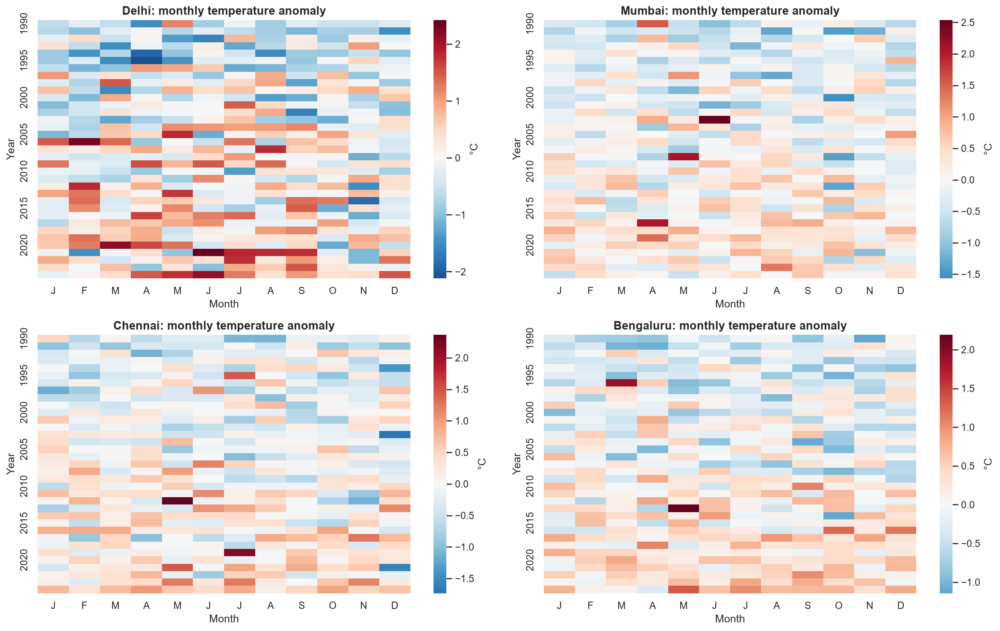 | 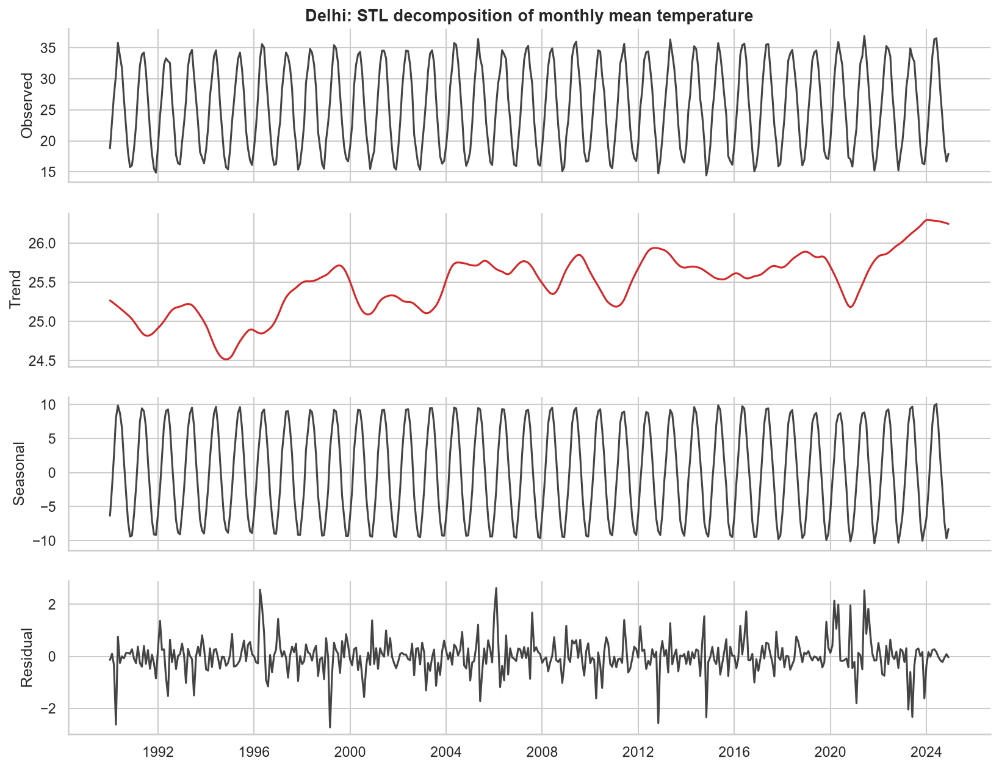 |
| 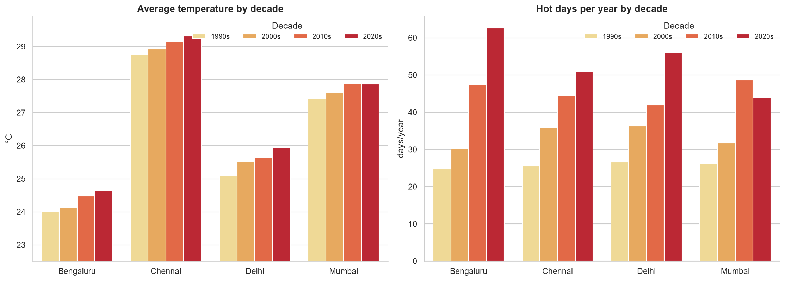 | 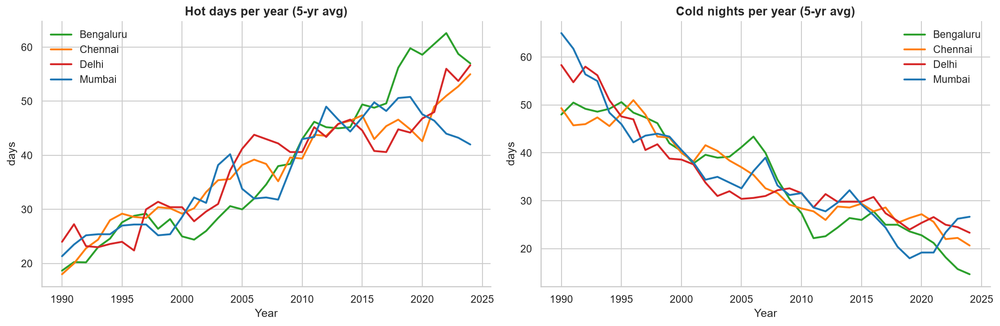 |
| 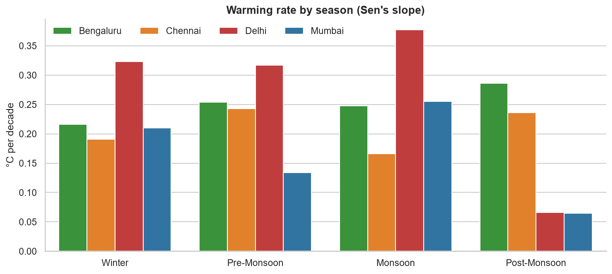 | 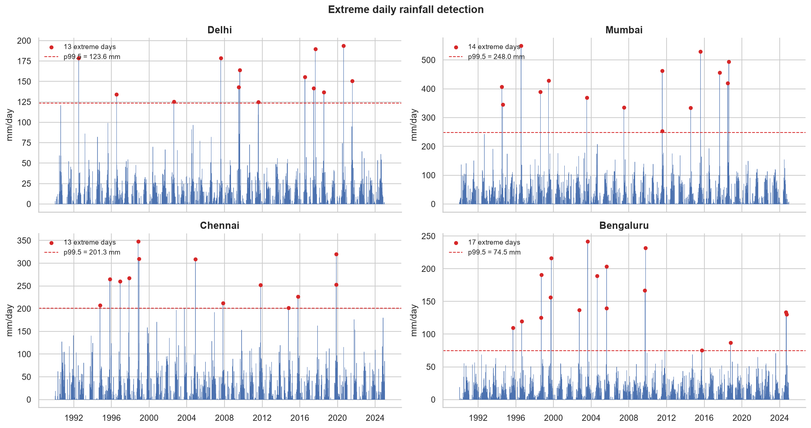 |
| 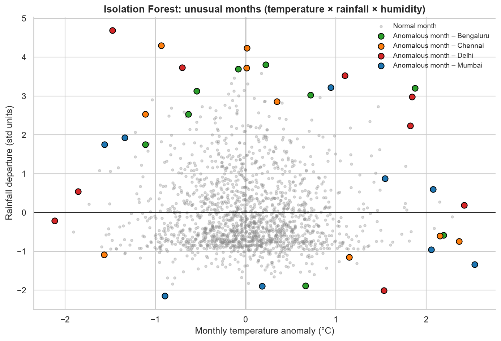 | 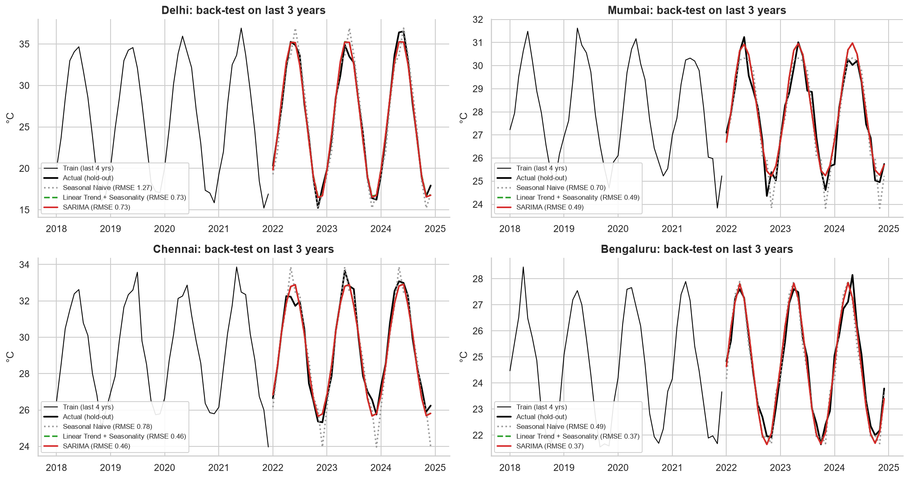 |
| 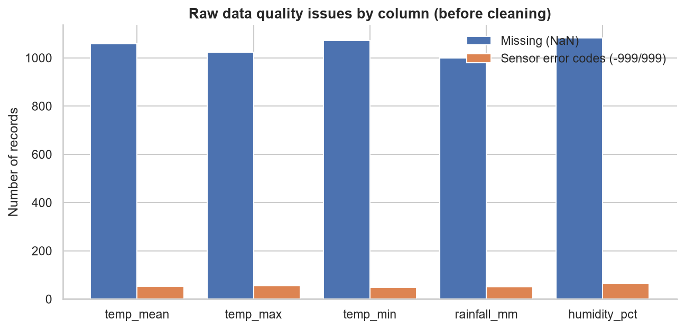 | 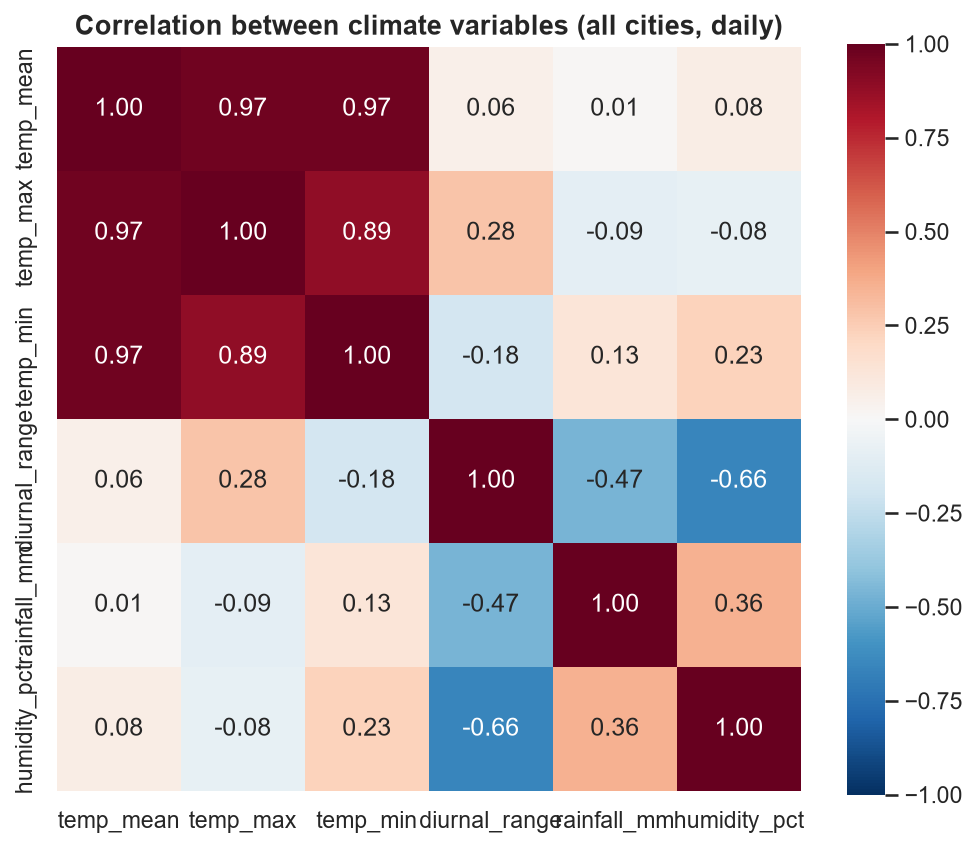 |
</details>

📄 Full auto-generated report: [`reports/climate_insights_report.md`](reports/climate_insights_report.md)

### Recommendations
- **Planners:** prioritise heat-action plans — hot-day frequency is rising in every city.
- **Drainage authorities:** design for extreme single-day rainfall, not annual averages.
- **Health departments:** use the anomaly detector as a heatwave early-warning trigger.

## 📸 Screenshots

### Dashboard demo
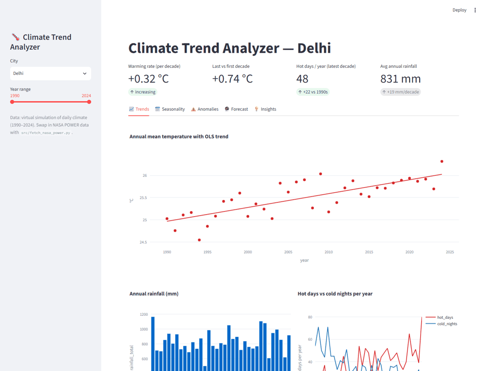

| Dashboard – Trends | Dashboard – Anomalies |
|---|---|
|  | 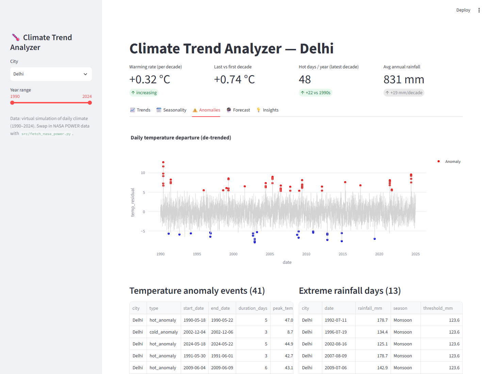 |
| **Dashboard – Forecast** | **Dashboard – Insights** |
| 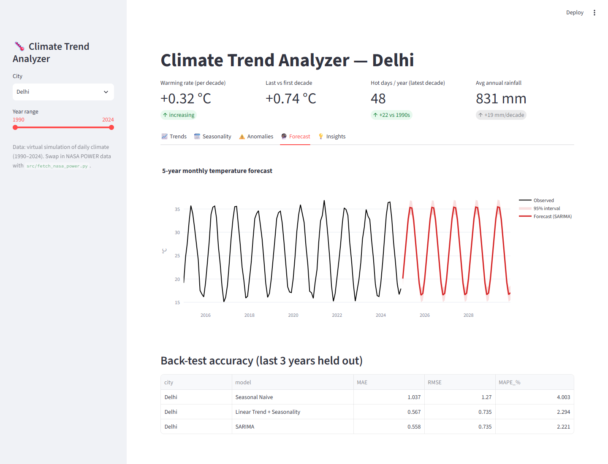 | 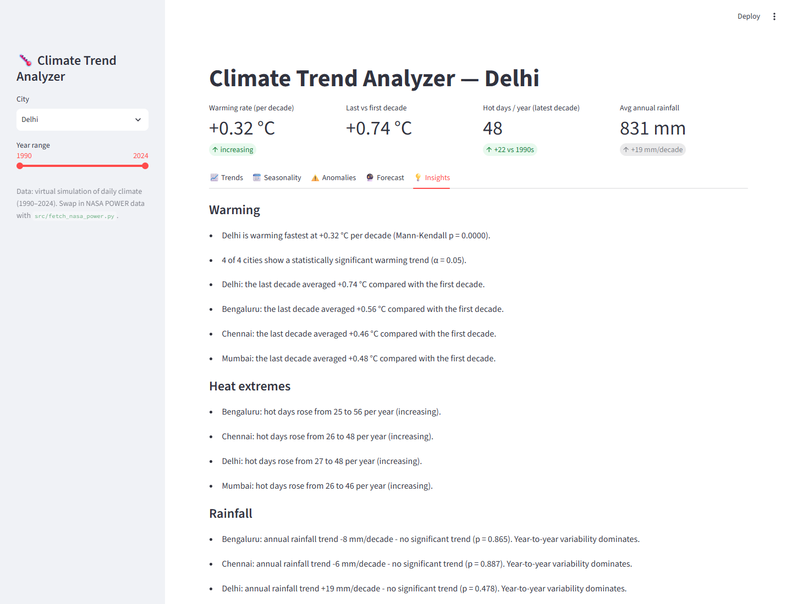 |
| **Pipeline run (`python main.py`)** | **Unit tests (`pytest -v`)** |
| 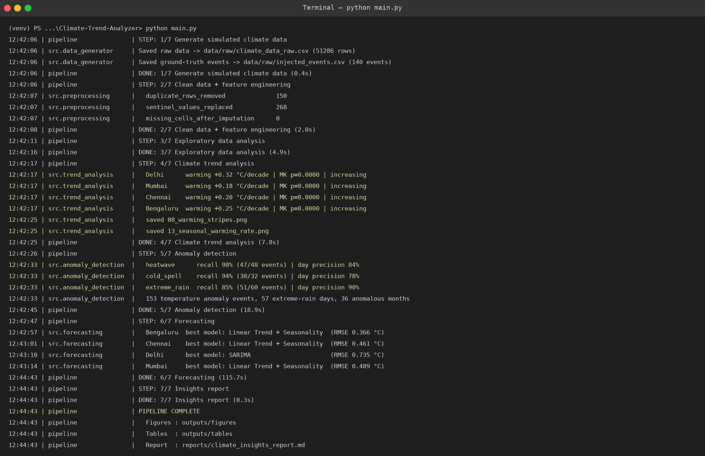 | 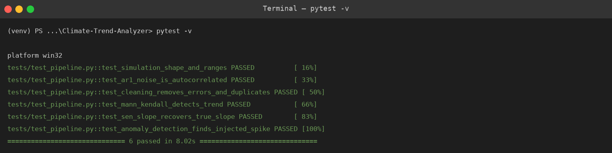 |

Re-capture after changes: `python scripts/capture_screenshots.py` (dashboard + GIF) and `python scripts/make_social_images.py` (terminal views + social-media images).

## 🔭 Future improvements
Real-data validation (NASA POWER / IMD) · region-wise comparison · Prophet / XGBoost forecasting · GEV return periods for extreme rainfall · climate-risk scoring · pollution–climate analysis · geospatial map dashboard · live Open-Meteo API · automated monthly reports via GitHub Actions. Details: [`docs/05_FUTURE_IMPROVEMENTS.md`](docs/05_FUTURE_IMPROVEMENTS.md).

## 🎓 Learning outcomes
- Designing a **modular, config-driven** data pipeline with logging and tests
- **Time-series cleaning**: sentinel codes, calendar gaps, interpolation vs climatology imputation
- **Climate statistics**: climate normals, anomalies, Mann-Kendall, Sen's slope, STL decomposition
- **Anomaly detection** (statistical + ML) and how to **evaluate** it with ground truth
- **Forecast back-testing** and why a naive baseline matters
- Communicating results via **charts, an auto-generated report and a dashboard**

## 📚 Documentation
| Doc | Contents |
|---|---|
| [01 Project guide](docs/01_PROJECT_GUIDE.md) | Concepts, tech-stack options, architecture, phases, setup, file-by-file code guide, simulation, how to run |
| [02 GitHub & proof guide](docs/02_GITHUB_AND_PROOF_GUIDE.md) | Upload steps, commit plan, screenshot checklist |
| [03 Career kit](docs/03_CAREER_KIT.md) | Resume bullets, LinkedIn posts, interview Q&A |
| [04 Troubleshooting](docs/04_TROUBLESHOOTING.md) | Common errors and fixes |
| [05 Future improvements](docs/05_FUTURE_IMPROVEMENTS.md) | Upgrade roadmap |
| [06 Social media posts](docs/06_SOCIAL_MEDIA_POSTS.md) | LinkedIn & Instagram captions + images |

## 👤 Author
**Sadhanala Nischay Prasad** — aspiring Data Scientist / Climate Data Analyst
[LinkedIn](https://linkedin.com/in/your-profile) · [GitHub](https://github.com/SNischayPrasad)

⭐ If you found this useful, consider starring the repo!
