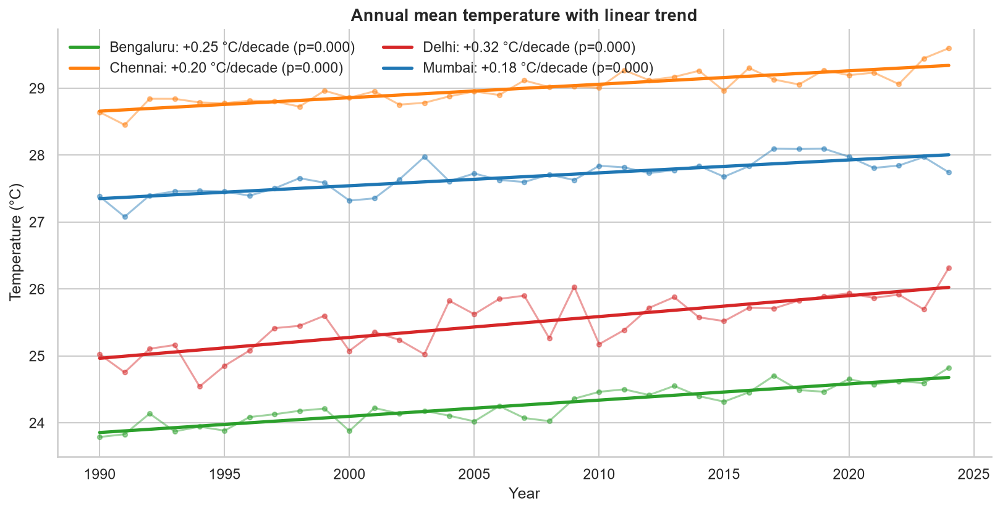
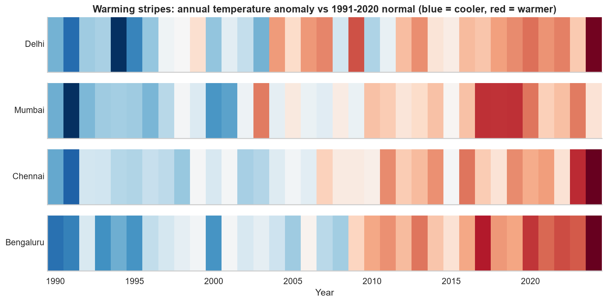
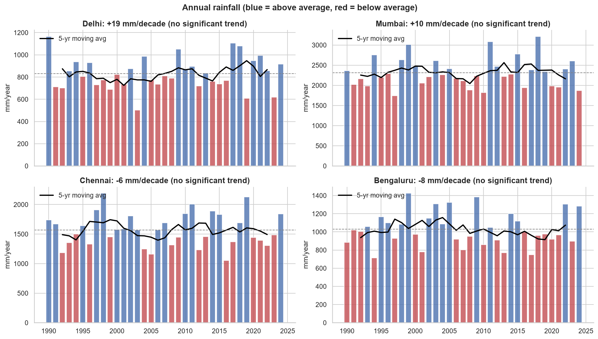
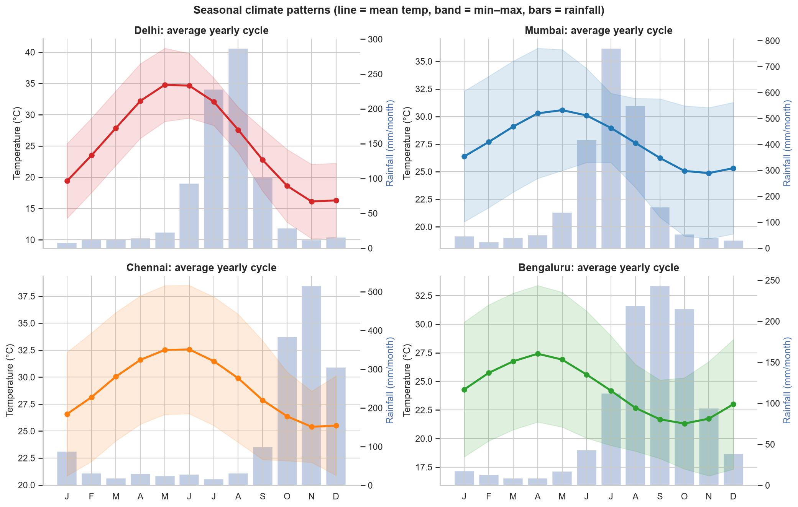
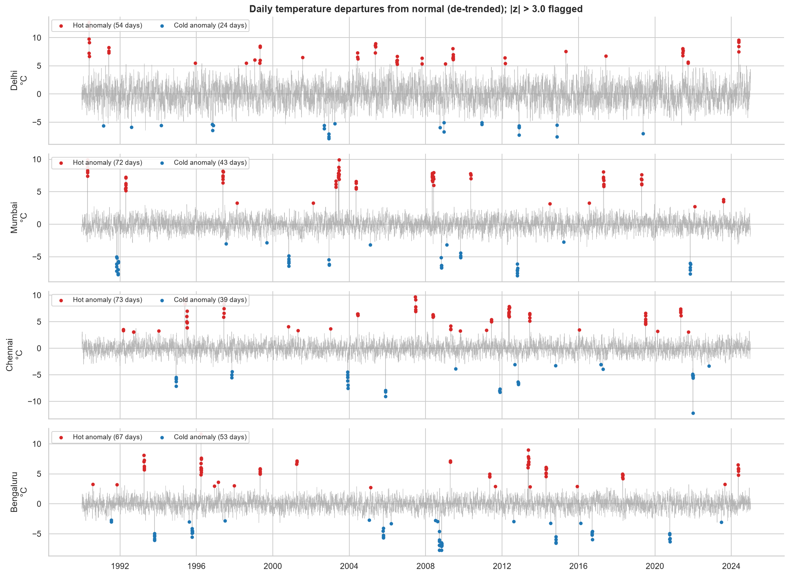
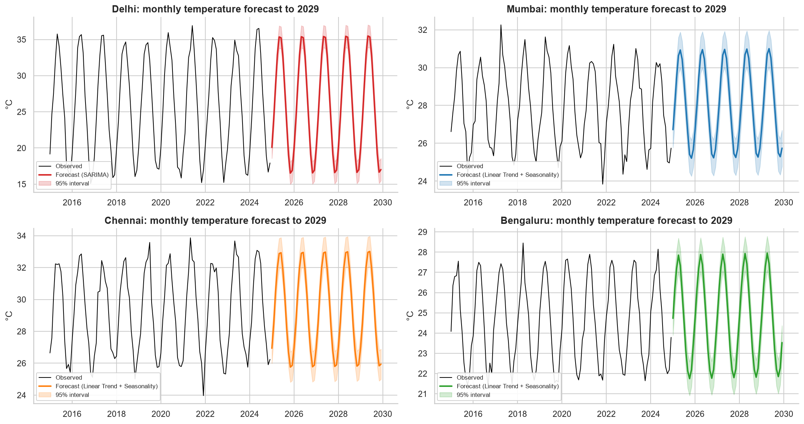

# Climate Trend Analyzer – Insights Report
_Generated automatically on 2026-10-16 12:44_  
_Period analysed: 1990–2024 · Cities: Delhi, Mumbai, Chennai, Bengaluru · Baseline normal: 1991–2020_

> **Data note:** results are produced on a *virtual simulation* of daily climate data (see `src/data_generator.py`). The same pipeline runs unchanged on real public data (NASA POWER via `src/fetch_nasa_power.py`).

## 1. Key insights
- **Warming:** Delhi is warming fastest at +0.32 °C per decade (Mann-Kendall p = 0.0000).
- **Warming:** 4 of 4 cities show a statistically significant warming trend (α = 0.05).
- **Warming:** Delhi: the last decade averaged +0.74 °C compared with the first decade.
- **Warming:** Bengaluru: the last decade averaged +0.56 °C compared with the first decade.
- **Warming:** Chennai: the last decade averaged +0.46 °C compared with the first decade.
- **Warming:** Mumbai: the last decade averaged +0.48 °C compared with the first decade.
- **Heat extremes:** Bengaluru: hot days rose from 25 to 56 per year (increasing).
- **Heat extremes:** Chennai: hot days rose from 26 to 48 per year (increasing).
- **Heat extremes:** Delhi: hot days rose from 27 to 48 per year (increasing).
- **Heat extremes:** Mumbai: hot days rose from 26 to 46 per year (increasing).
- **Rainfall:** Bengaluru: annual rainfall trend -8 mm/decade - no significant trend (p = 0.865). Year-to-year variability dominates.
- **Rainfall:** Chennai: annual rainfall trend -6 mm/decade - no significant trend (p = 0.887). Year-to-year variability dominates.
- **Rainfall:** Delhi: annual rainfall trend +19 mm/decade - no significant trend (p = 0.478). Year-to-year variability dominates.
- **Rainfall:** Mumbai: annual rainfall trend +10 mm/decade - no significant trend (p = 0.909). Year-to-year variability dominates.
- **Seasonal shift:** Fastest seasonal warming: Delhi in Monsoon (+0.38 °C/decade).
- **Anomalies:** 153 temperature anomaly events detected; most extreme: Bengaluru hot anomaly starting 1996-03-25 (z = 10.74).
- **Anomalies:** 57 extreme-rainfall days detected; wettest: Mumbai on 1996-07-22 with 549 mm.
- **Forecast:** Bengaluru: projected annual mean temperature in 2029 ≈ 24.81 °C.
- **Forecast:** Chennai: projected annual mean temperature in 2029 ≈ 29.44 °C.
- **Forecast:** Delhi: projected annual mean temperature in 2029 ≈ 26.18 °C.
- **Forecast:** Mumbai: projected annual mean temperature in 2029 ≈ 28.10 °C.

## 2. Data quality
| check | value |
|---|---|
| raw_rows | 51286 |
| raw_missing_cells | 5234 |
| unparseable_dates_dropped | 0 |
| duplicate_rows_removed | 150 |
| sentinel_values_replaced | 268 |
| out_of_range_values_removed | 0 |
| min_max_swaps | 0 |
| missing_cells_before_imputation | 5489 |
| missing_cells_after_imputation | 0 |
| clean_rows | 51136 |

## 3. Long-term temperature trend
| city | sen_slope_per_decade | ols_slope_per_decade | mk_p_value | trend | change_last_vs_first_decade |
|---|---|---|---|---|---|
| Bengaluru | 0.247 | 0.242 | 0.0 | increasing | 0.563 |
| Chennai | 0.196 | 0.201 | 0.0 | increasing | 0.46 |
| Delhi | 0.318 | 0.312 | 0.0 | increasing | 0.741 |
| Mumbai | 0.185 | 0.193 | 0.0 | increasing | 0.476 |

## 4. Rainfall & seasonality

## 5. Anomalies
### Top 10 temperature anomaly events
| city | type | start_date | end_date | duration_days | peak_temp | peak_zscore | mean_anomaly_c | severity |
|---|---|---|---|---|---|---|---|---|
| Bengaluru | hot_anomaly | 1996-03-25 | 1996-04-03 | 10 | 38.62 | 10.74 | 6.68 | Extreme |
| Chennai | cold_anomaly | 2021-12-27 | 2021-12-31 | 5 | 20.99 | -9.22 | -6.71 | Extreme |
| Mumbai | hot_anomaly | 2003-06-15 | 2003-06-20 | 6 | 39.89 | 7.8 | 8.2 | Extreme |
| Bengaluru | cold_anomaly | 2008-10-30 | 2008-11-03 | 5 | 14.95 | -7.37 | -6.99 | Extreme |
| Chennai | hot_anomaly | 2007-06-18 | 2007-06-22 | 5 | 42.27 | 7.12 | 8.18 | Extreme |
| Bengaluru | cold_anomaly | 2008-09-16 | 2008-09-21 | 6 | 17.01 | -6.94 | -6.4 | Extreme |
| Chennai | cold_anomaly | 2005-11-23 | 2005-11-25 | 3 | 17.31 | -6.88 | -8.4 | Extreme |
| Bengaluru | hot_anomaly | 2013-05-17 | 2013-05-22 | 6 | 35.92 | 6.82 | 7.5 | Extreme |
| Mumbai | cold_anomaly | 1991-11-24 | 1991-11-28 | 5 | 18.94 | -6.81 | -6.8 | Extreme |
| Mumbai | cold_anomaly | 2021-11-04 | 2021-11-08 | 5 | 19.08 | -6.68 | -6.71 | Extreme |

### Detection quality vs. injected ground truth
| event_type | injected_events | events_detected | event_recall | flagged_days | day_precision |
|---|---|---|---|---|---|
| heatwave | 48 | 47 | 0.979 | 266 | 0.835 |
| cold_spell | 32 | 30 | 0.938 | 159 | 0.78 |
| extreme_rain | 60 | 51 | 0.85 | 57 | 0.895 |

## 6. Forecast (back-test on last 3 years)
| city | model | MAE | RMSE | MAPE_% |
|---|---|---|---|---|
| Bengaluru | Seasonal Naive | 0.417 | 0.495 | 1.687 |
| Bengaluru | Linear Trend + Seasonality | 0.307 | 0.366 | 1.242 |
| Bengaluru | SARIMA | 0.31 | 0.369 | 1.252 |
| Chennai | Seasonal Naive | 0.591 | 0.783 | 2.08 |
| Chennai | Linear Trend + Seasonality | 0.362 | 0.461 | 1.231 |
| Chennai | SARIMA | 0.364 | 0.464 | 1.236 |
| Delhi | Seasonal Naive | 1.037 | 1.27 | 4.003 |
| Delhi | Linear Trend + Seasonality | 0.567 | 0.735 | 2.294 |
| Delhi | SARIMA | 0.558 | 0.735 | 2.221 |
| Mumbai | Seasonal Naive | 0.57 | 0.699 | 2.107 |
| Mumbai | Linear Trend + Seasonality | 0.384 | 0.489 | 1.392 |
| Mumbai | SARIMA | 0.387 | 0.492 | 1.403 |

## 7. Recommendations
- **Urban planners:** prioritise heat-action plans (cool roofs, shaded transit stops) in the fastest-warming city; hot-day frequency is rising everywhere.
- **Water & drainage authorities:** design for extreme single-day rainfall, not the annual average – the annual total shows no clear trend while extremes still occur.
- **Public health:** use the anomaly-event detector as an early-warning trigger for heatwave advisories.
- **Next analytical step:** validate the pipeline on NASA POWER / IMD observations and add region-level comparison.